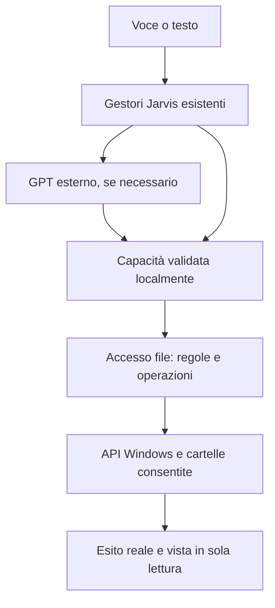

# Accesso file — implementazione e candidato Windows

**Build candidata consegnabile: controlli finali Windows completati e ZIP pubblicato.** Sorgenti esatti 7298fb632cd9b72386fd7a30f469b307ce7e6fa5, [run Windows 41322290359](https://github.com/MATRIXNEO23/jarvis/actions/runs/41322290359). [Scarica ZIP persistente](https://raw.githubusercontent.com/MATRIXNEO23/jarvis/main/Download/Jarvis-Accesso-File-0.1.0-20261101-7298fb6.zip). Base preservata: b936879 / Timer Audio Fix2. Sorgenti nel ramo feature/file-access-20261101; main conserva catalogo e continuità, non va sovrascritta la sua radice storica.

## Comportamento realizzato

- Add-on descrittiva AccessoFile.jaddon, stesso gestore schema 1 esteso con sole azioni revisionate; registrazione incorporata inizialmente spenta. Nessun import arbitrario o framework nuovo.
- Configurazione dentro Gestisci add-on → Accesso file → Configura: dischi/cartelle, sottocartelle incluse, eccezioni e stato parziale; caricamento al momento dell'espansione, non scansione completa iniziale.
- Utente/cartelle note e identità del volume ricavati da Windows. Regole persistenti nel profilo Jarvis selezionato, controllo della destinazione reale e dei nomi DOS brevi. Le spunte non modificano i diritti Windows.
- Un servizio unico per ricerca, elenco, scelta e lettura/apertura: comandi locali esistenti ampliati, stessi ingressi testo/voce, capacità GPT validate e controllate nuovamente localmente. Chiarimento/numero collegati ai risultati correnti, scadenza e revoca al cambio progetto/disattivazione/annullamento. Chiacchiera non significa comando.
- Ricerca indicizzata quando disponibile; fallback diretto con priorità alle cartelle personali consentite, limite 5000 elementi/10 secondi/20 risultati, risultato parziale dichiarato e annullamento. Nessun indicizzatore nuovo o scansione continua.
- Lettura senza modifica e vista interna di TXT/MD/JSON/LOG/CSV/INI/YAML in UTF-8/UTF-16, massimo 256 KiB; script/eseguibili/PDF/Office non eseguiti per leggerli. Cartelle aperte con Explorer: accettazione distinta da finestra osservata.
- Spiegazione solo se richiesta: estratto fino a 1800 caratteri, budget massimo del bridge rispettato, testo trattato come dati e risposta chat mai reinviata al dispatcher delle azioni. Nessuna lettura indiscriminata inviata al modello.
- Cartelle d'installazione candidate ricavate anche dalle registrazioni Windows del programma; non una ricerca semantica universale dei dati/salvataggi di qualsiasi app. Nessun percorso fittizio di Minecraft.
- Componente spento/rimosso, radici assenti/revocate, dati di configurazione corrotti, accesso negato, dipendenza/file mancante: rifiuto o messaggio utile; funzioni indipendenti preservate.

## Organizzazione e integrazione

| Responsabilità | Sorgenti |
|---|---|
| Informazioni/API native Windows e indice | file_access/windows.py, windows_search.ps1 |
| Regole, esclusioni, profilo e identità persistenti | file_access/policy.py |
| Operazioni, ricerca e scelte nel dialogo | file_access/service.py |
| Spunte e vista testo senza modifica | file_access/ui.py |
| Collegamenti esistenti estesi | addon_manager.py, addon_ui.py, capability_registry.py, local_engine.py, conversation_router.py, jarvis.py |
| Preparazione/avvio isolato e helper | avvia_jarvis.bat, prepara_test_telegram50.py; offline_tts.py solo per cwd/eseguibile del processo nativo |
| Verifiche e confezione | tests/test_file_access.py; tools/probe_file_access_windows.py, build_file_access.py, check_file_access_package.py; CI Windows |

Questa mappa rappresenta l'incremento sulla base b936879. La vecchia mappa Archify del nucleo a86c2c9 resta riferita al ramo successivo, non viene spacciata per la struttura di questa build.

## Configurazione, consegna e ritorno alla base

Profilo candidato LOCALAPPDATA/Jarvis-AccessoFile-Trial, distinto dal precedente. Prima copia consistente tramite il preparatore esistente dal profilo Telegram50 se presente, altrimenti Jarvis; agli avvii successivi dati esistenti conservati. Il launcher resta unico. Impostazioni del microfono secondo la base, nessuna adozione implicita dello standby del nucleo successivo.

ZIP operativo: moduli Python eseguiti, script/risorse necessari, manifest, istruzioni essenziali e VERSIONE.json con commit e hash dei file. Nessun test, handoff, AGENTS, CI, cartella Download o documento di sviluppo nel pacchetto. ZIP unico per commit in Download, con JSON integrità e collegamento in cima al catalogo; niente sovrascrittura dei pacchetti precedenti. La pubblicazione dipende da entrambi i job Windows e dalla verifica estratta.

Per tornare alla base chiudere il candidato e usare la precedente cartella Timer Audio Fix2; non cancellare profili, database, file o pacchetti. Il riferimento funzionante confermato dall'utente resta b936879 finché non collauda sul PC la nuova versione identificata. Test automatici e riscontro PC non sono equivalenti.

## Prove e lezioni del percorso

| Passaggio | Evidenza e risultato |
|---|---|
| Nativo iniziale | 7955efe, run 41319370085: API profilo/percorsi/volumi PASS su Windows 3.11/3.12; indice non disponibile nel runner |
| Prima integrazione | 4f04df4, run 41320489345: sei fallimenti nei nuovi test; nomi DOS brevi e percorsi lunghi non uniformati |
| Correzione nomi | 0e6c95c, run 41320795402: tre fallimenti residui su lettura diretta; selezioni/UI/policy nomi corrette |
| Attivazione/annullamento | cb28d23, run 41321205382: 390 test Windows e 17 estratti PASS, avvio/chiusura UI PASS; flag annullamento corretto per nuove richieste |
| Rifinitura | 63bfd04, run 41321679044: suite e pacchetto Windows PASS; candidato precedente conservato in Download |
| Ricerca intero disco | c20e6cf, run 41321937405: 393 test e 20 estratti PASS, avvio/chiusura UI PASS; pulizia finale fallita per directory tenuta da helper nativo, pubblicazione bloccata |
| Chiusura/processi | 7298fb6, run 41322290359: 393 test per job Windows 3.11/3.12, zero skip; 20 test propri dallo ZIP estratto, import, avvio/chiusura/rilascio directory PASS; pubblicazione Download PASS |

Lezioni operative: confrontare alias e percorsi effettivi; non rimuovere un'esclusione perché la cartella è ricreata; non riautorizzare un volume sostituito salvando altre opzioni; cancellazione revoca anche scelte pendenti; i test del pacchetto estratto devono includere avvio, chiusura e rilascio della cartella.

Nuovi test soltanto Windows, come richiesto. Voce nelle prove automatiche: trascrizione/callback simulati e routing reale; nessun microfono fisico o account GPT personale. Indice Windows assente nel runner: successo del fallback non prova recupero reale dall'indice. Restano prova sul Pavilion, RAM/CPU/disco sul target e qualità del dialogo col suo account. Nessuna misura di consumo inventata, nessuna garanzia universale.

## Riferimento della consegna

- ZIP: Download/Jarvis-Accesso-File-0.1.0-20261101-7298fb6.zip, 249396 byte, 78 file operativi.
- SHA-256: 72c6d57a9a258fe7c875cfdc8646bc4ddf5b75417aa748bb5d4d4b7ef3e96755.
- Git blob ZIP: 09e3ef994a0ca38475844f0fd8e22334e8dba4c4.
- Windows 3.12 job 124894870772: 393 test PASS; 20 test estratti PASS; EXTRACTED_IMPORTS_OK, EXTRACTED_UI_BOOT_AND_CLOSE_OK, EXTRACTED_PACKAGE_CHECKS_OK.
- Windows 3.11 job 124894870793: 393 test PASS. Nessun nuovo test Linux eseguito.
- Publisher Windows job 124895334435: verifica dei byte ricevuti, CRC/hash, commit e push in Download PASS. Metadata JSON della consegna riletti via GitHub e coincidenti.
- Collaudo PC/account GPT/microfono fisico e misura consumi Pavilion: pendenti; non promuovere il candidato a nuova BASE-UTENTE senza riscontro sul pacchetto esatto.
- Primo passo utente: estrarre in cartella nuova e avviare avvia_jarvis.bat; poi ingranaggio → Progetti e servizi → Gestisci add-on → Accesso file → Configura, selezionare cartella, Salva e Attiva. Provare con un TXT conosciuto.
